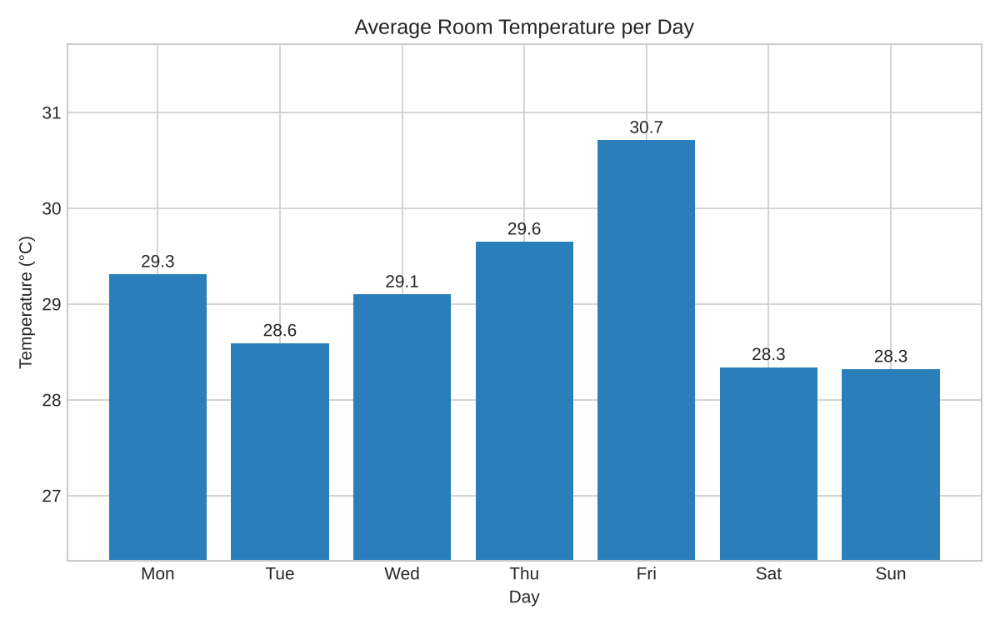
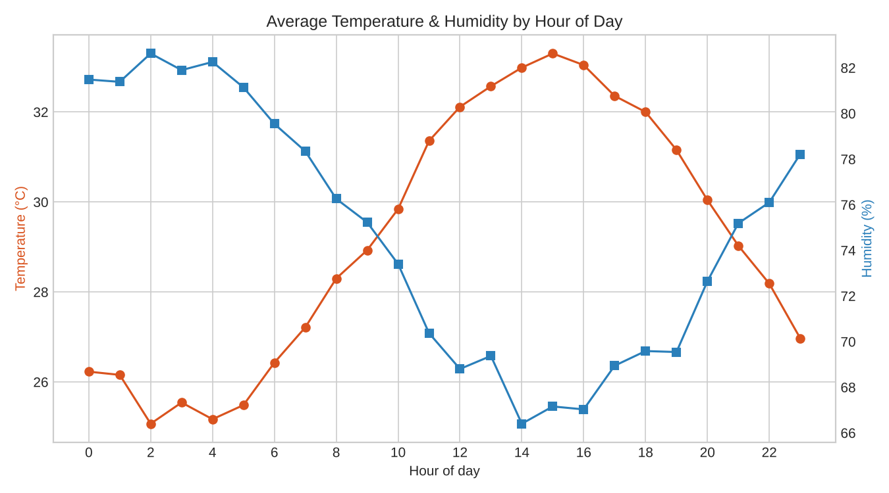
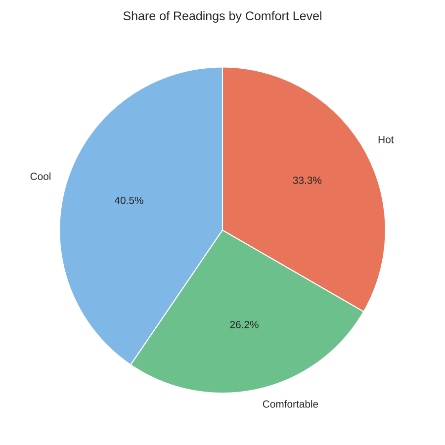
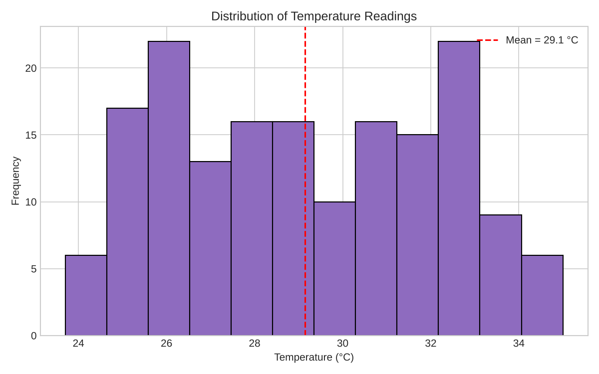

# Smart Room Environment Monitoring – Data Analytics Project

**Name:** Jabez Arwin M
**Department:** Electronics and Communication Engineering (1st year), St. Joseph's College of Engineering
**Register No.:** _(add your register number)_

## 1. Objective
To create a dataset, perform statistical computation, and visualize it using bar, line, pie and histogram charts.

## 2. Dataset
`data.csv` – 168 records (24 hourly readings × 7 days) of the kind a room sensor node (ESP32 + DHT22 temperature/humidity sensor + LDR light sensor) would log.

| Column | Description |
|---|---|
| Day | Day of the week |
| Hour | Hour of the day (0–23) |
| Temperature_C | Room temperature in °C |
| Humidity_pct | Relative humidity in % |
| Light_lux | Light intensity in lux |
| Comfort | Cool (<28 °C), Comfortable (28–31 °C), Hot (>31 °C) |

**Source:** Self-created (simulated) dataset generated by `analysis.py` using Python/NumPy with a fixed random seed (42) so results are reproducible. Values follow a realistic daily cycle with random noise.

## 3. Computation (see `results.txt`)
- Mean temperature: **29.15 °C**, median: **28.90 °C**, std. deviation: **2.98**
- Max / min temperature: **35.0 °C / 23.7 °C**
- Hottest hour on average: **15:00**, coolest: **02:00**
- Correlation (temperature vs humidity): **-0.926** (strong negative)
- Correlation (temperature vs light): **0.618** (moderate positive)
- Comfort readings: Cool 68, Hot 56, Comfortable 44

## 4. Visualizations
| Chart | File | What it shows |
|---|---|---|
| Bar | `bar_chart.png` | Average temperature for each day of the week (Friday is warmest) |
| Line | `line_chart.png` | Temperature and humidity through the day – temperature peaks in the afternoon while humidity dips |
| Pie | `pie_chart.png` | Share of readings that were Cool / Comfortable / Hot |
| Histogram | `histogram.png` | Distribution of all temperature readings |






## 5. How to run
```
pip install pandas matplotlib numpy
python analysis.py
```

## 6. Conclusion
Temperature follows a clear daily cycle, peaking around 3 PM, and rises as humidity falls (strong negative correlation). Such analysis is useful for smart-room and IoT environment monitoring systems.

## Tools used
Python, pandas, NumPy, matplotlib
